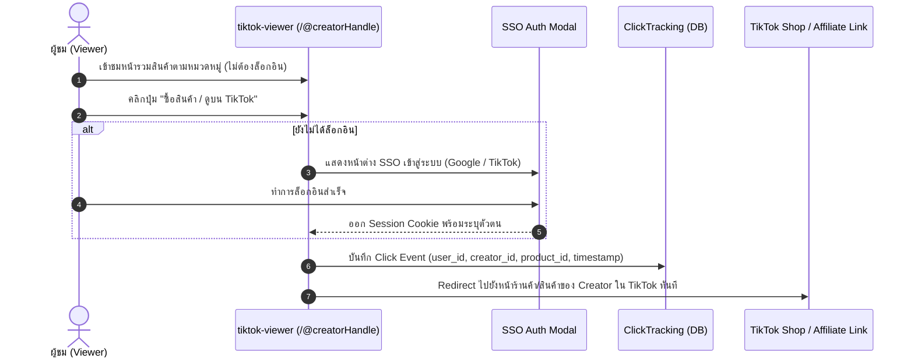

# TikTok Catalog & Backoffice System Changelog

> บันทึกประวัติการพัฒนา สถาปัตยกรรมระบบ และข้อตกลงทางเทคนิค เพื่อให้ทำงานต่อได้อย่างต่อเนื่องโดยไม่ต้องอ่านย้อนหลังทั้งหมด

---

## [2026-10-17] - สถาปัตยกรรมระบบและโครงสร้างเริ่มต้น (System Architecture & Initial Setup)

### 1. วัตถุประสงค์และปัญหาที่แก้ไข (Problem & Scope)
- **ปัญหา:** Creator ทำช่อง TikTok มีสินค้าและคลิปรีวิวจำนวนมากบน TikTok แต่การรวมลิงก์สินค้าและจัดหมวดหมู่ใน Bio ทำได้จำกัด
- **โซลูชัน:** สร้างระบบเว็บแบบ Multi-tenant (ระบบแยกข้อมูลตามเจ้าของร้าน) แบ่งออกเป็น 2 ส่วนหลัก:
  1. `tiktok-viewer`: เว็บไซต์หน้าร้านสำหรับให้ผู้ติดตามดูสินค้า จัดหมวดหมู่ และกดสั่งซื้อ
  2. `tiktok-backoffice`: ระบบหลังบ้านสำหรับ Creator และทีมงาน เพื่อจัดกลุ่มสินค้า แปะคลิปรีวิว และจัดการสิทธิ์

---

### 2. โครงสร้างโฟลเดอร์โปรเจกต์ (Monorepo Directory Layout)
จัดการแบบ Monorepo ผ่าน Yarn Workspaces ภายใต้โฟลเดอร์หลัก `tiktok/`:

```
tiktok/
├── tiktok-viewer/              # Next.js App Router (Public Catalog & Buy Redirection)
├── tiktok-backoffice/          # Next.js App Router (Creator & Admin Dashboard with RBAC)
├── packages/
│   ├── database/               # Shared TypeORM Entities & PostgreSQL Data Source
│   ├── auth/                   # Shared SSO & Session Auth Configurations (Auth.js / NextAuth)
│   └── types/                  # Shared TypeScript Interfaces, Enums & DTOs
├── docs/
│   └── specs/                  # Detailed System Specification Docs
├── changelog.md                # บันทึกประวัติและ Roadmap สำหรับ Agent Handoff
└── package.json                # Root Yarn Workspaces Configuration
```

---

### 3. สถาปัตยกรรมระบบยืนยันตัวตนและการควบคุมสิทธิ์ (Authentication & RBAC Architecture)

#### 3.1 การยืนยันตัวตน (Authentication & SSO)
- **SSO (Single Sign-On):** รองรับ Multi-Provider (Google OAuth, Email/Password, และต่อยอด TikTok Login API) ผ่าน Auth.js (NextAuth v5)
- **Session Management:** จัดเก็บ Session ใน **HttpOnly Secure Cookie** ป้องกันการโจมตีผ่าน XSS (Cross-Site Scripting)

#### 3.2 บทบาทและสิทธิ์ผู้ใช้งาน (Role-Based Access Control - RBAC)
- **SUPER_ADMIN:** จัดการภาพรวมระบบ ดูแล Creator ทั้งหมด ตรวจสอบ Audit Log
- **CREATOR:** จัดการเฉพาะสินค้า, หมวดหมู่, คลิปรีวิว และตั้งค่า TikTok Shop Link ของร้านตนเอง (Data Isolation)
- **STAFF:** ทีมงานที่ได้รับมอบหมายจาก Creator ให้ช่วยจัดการสินค้าตาม Permission ที่ได้รับ (เช่น เพิ่มสินค้า, จัดหมวดหมู่)
- **VIEWER:** ผู้ชมทั่วไปที่เข้าชมหน้ารวมสินค้าได้โดยไม่ต้องล็อกอิน

#### 3.3 โฟลว์การซื้อสินค้า (Viewer-to-TikTok Shop Referral Flow)


---

### 4. การออกแบบโมเดลฐานข้อมูล (Database Schema Design - TypeORM)

#### Entities หลักใน `packages/database`:
1. **User (`users`):**
   - `id`: UUID (Primary Key)
   - `email`: VARCHAR(255) UNIQUE
   - `display_name`: VARCHAR(255)
   - `creator_handle`: VARCHAR(100) UNIQUE (เช่น `@pond`)
   - `tiktok_shop_url`: TEXT (ลิงก์ร้านค้าหลักบน TikTok)
   - `avatar_url`: TEXT
   - `role`: ENUM (`SUPER_ADMIN`, `CREATOR`, `STAFF`, `VIEWER`)
   - `created_at`, `updated_at`

2. **Category (`categories`):**
   - `id`: UUID (Primary Key)
   - `creator_id`: UUID (Foreign Key -> `users.id`)
   - `name`: VARCHAR(100) (ชื่อหมวดหมู่สินค้า)
   - `slug`: VARCHAR(120) (URL slug เช่น `beauty-skincare`)
   - `sort_order`: INT (ลำดับการแสดงผล Drag-and-Drop)
   - `is_active`: BOOLEAN

3. **Product (`products`):**
   - `id`: UUID (Primary Key)
   - `creator_id`: UUID (Foreign Key -> `users.id`)
   - `category_id`: UUID (Foreign Key -> `categories.id`)
   - `title`: VARCHAR(255) (ชื่อสินค้า)
   - `description`: TEXT (รายละเอียด)
   - `price`: DECIMAL(10, 2) (ราคาปกติ)
   - `discount_price`: DECIMAL(10, 2) (ราคาพิเศษ/ลดราคา)
   - `image_url`: TEXT
   - `product_type`: ENUM (`TIKTOK_SHOP`, `TIKTOK_AFFILIATE`, `EXTERNAL_LINK`)
   - `tiktok_product_url`: TEXT (ลิงก์สินค้าปักตะกร้า หรือ Affiliate)
   - `tiktok_video_url`: TEXT (ลิงก์คลิปวิดีโอรีวิวบน TikTok)
   - `click_count`: INT DEFAULT 0 (จำนวนครั้งที่ถูกกดไปซื้อ)
   - `sort_order`: INT
   - `is_active`: BOOLEAN

4. **ClickTracking (`click_trackings`):**
   - `id`: UUID (Primary Key)
   - `product_id`: UUID (Foreign Key -> `products.id`)
   - `creator_id`: UUID (Foreign Key -> `users.id`)
   - `viewer_user_id`: UUID NULLABLE (Foreign Key -> `users.id`)
   - `ip_address`: VARCHAR(45)
   - `user_agent`: TEXT
   - `created_at`: TIMESTAMP

---

### 5. กฎระเบียบและข้อบังคับทางเทคนิค (Development Rules)
1. **Zero-Emoji Standard:** ห้ามใช้ Emoji บนหน้าจอ UI ทั้ง Viewer และ Backoffice เด็ดขาด ให้ใช้ Vector Icons (Material UI / Lucide) เท่านั้น
2. **Package Manager:** ใช้ `yarn` เสมอ ห้ามใช้ npm, pnpm หรือ bun
3. **Database Migration:** จัดการผ่าน TypeORM และระมัดระวังผลกระทบต่อข้อมูลจริง
4. **Git Operations:** ห้ามรัน `git push` เป็นอันขาด

---

### 6. แผนการดำเนินงานถัดไป (Roadmap & Next Steps)
- [x] ออกแบบสถาปัตยกรรมและกำหนด Folder Structure
- [x] สร้างบันทึก `changelog.md` และเอกสารสเปก
- [ ] ติดตั้งและตั้งค่า Root `package.json` (Yarn Workspaces)
- [ ] สร้างโมเดลฐานข้อมูล TypeORM ใน `packages/database` และ Shared Types ใน `packages/types`
- [ ] สร้างโครงสร้างแอป `tiktok-viewer` (Next.js, Tailwind, Catalog List & Redirect Flow)
- [ ] สร้างโครงสร้างแอป `tiktok-backoffice` (Next.js, Dashboard, Product CRUD, SSO & RBAC)

---

### Handoff Block
```
[KEYWORD: tiktok-catalog-core]
- Completed: วางสถาปัตยกรรมระบบ, โครงสร้างโฟลเดอร์หลัก tiktok/, และบันทึก changelog.md พร้อมสเปกระบบ
- Pending: ติดตั้ง Yarn Workspaces root, สร้าง TypeORM entities ใน packages/database, วางโค้ดเริ่มต้นของ tiktok-viewer และ tiktok-backoffice
- Next Action Prompt: เริ่มสร้าง root package.json สำหรับ Yarn Workspaces, ติดตั้งโมเดล TypeORM ใน packages/database และเริ่มต้นสร้าง Next.js Apps ทั้ง 2 ฝั่ง
```
